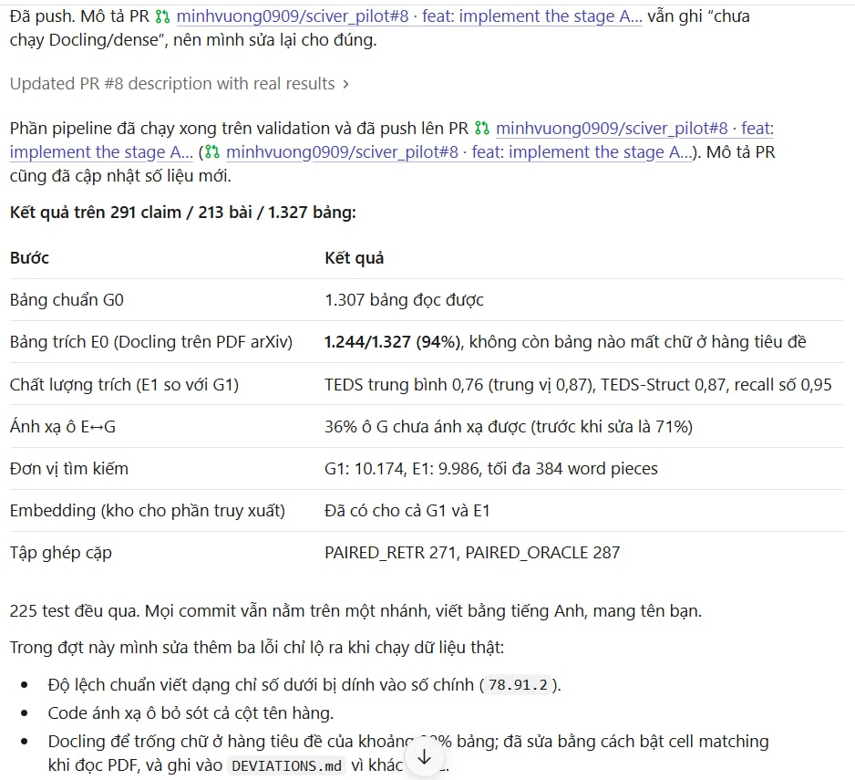
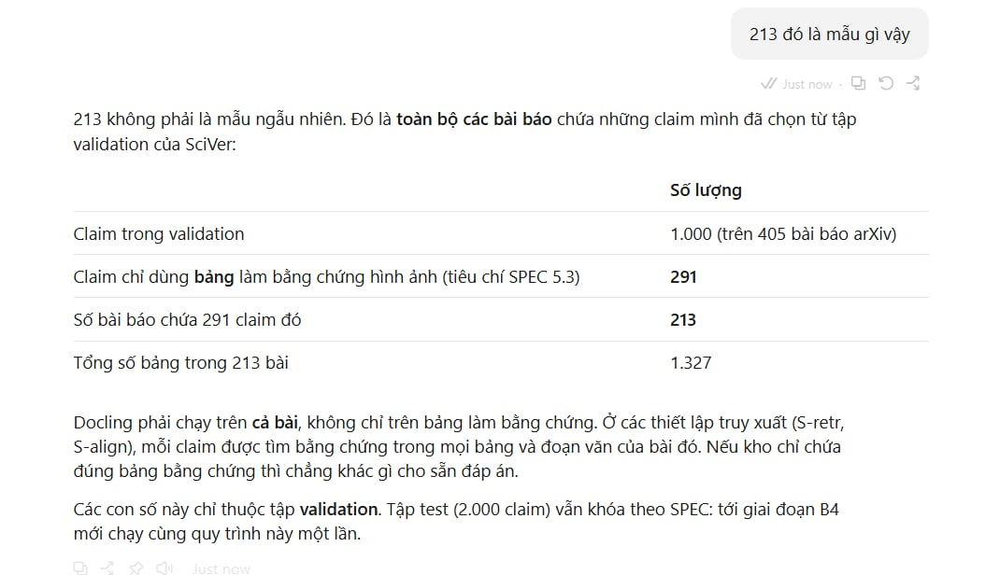

# Pilot SciVer: bảng dạng ảnh, bảng chuẩn và bảng trích (Qwen2.5-VL-7B)

Pilot 1 tuần trên **40 claim** dùng bảng của SciVer (ACL 2025), cùng dataset và model với paper.
Mục tiêu: đánh giá **độ ổn định** và **việc pipeline chạy trọn vẹn được hay không**, chưa kết luận cải thiện
(mỗi claim là 2,5 điểm %, khoảng tin cậy 95% rộng khoảng ±15 điểm).

## 1. Tổng quan pipeline

```
SciVer (validation)
   │  s01  chọn 40 claim dùng bảng (4 tập con × 10, mỗi tập con 5 Entailed / 5 Refuted)
   ▼
ảnh bảng (như paper) ──────────────────────────────────────────────► IMG ─┐
   │                                                                      │
   ├─ s03  bảng chuẩn từ JSON/HTML arXiv ──► G0 ──(s05 chuẩn hóa)──► G1 ──┤
   │        (nhóm kiểm tay gold_review.csv)                               │
   └─ s04  Docling trích bảng từ ảnh ─────► E0 ──(s05 chuẩn hóa)──► E1 ──┤
            s05: TEDS, TEDS-Struct, độ khớp số giữa E và G               │
                                                                          ▼
                      s06  Qwen2.5-VL-7B (vLLM), prompt CoT nguyên văn của SciVer
                           4 lần chạy: 3 seed ở temperature 1.0 (như paper) + 1 lần temperature 0
                                                                          ▼
                      s07  chấm điểm (cách cũ của SciVer và cách mới), độ ổn định,
                           đổi kết luận giữa các điều kiện, McNemar, summary.md
```

| Điều kiện | Bảng đưa vào model | Câu hỏi trả lời |
|---|---|---|
| IMG | Ảnh bảng, tiền xử lý giống code SciVer | Chạy lại baseline của paper |
| G0 / G1 | Bảng chuẩn dạng văn bản, chưa / đã chuẩn hóa | Mức trần khi đọc bảng đúng; chuẩn hóa có làm hỏng bảng chuẩn không |
| E0 / E1 | Bảng Docling dạng văn bản, chưa / đã chuẩn hóa | Tác động của lỗi trích xuất; chuẩn hóa có bù được không |

Khi bằng chứng là biểu đồ (claim "mixed"), biểu đồ vẫn được đưa vào dạng ảnh ở mọi điều kiện.

### Khác biệt so với code gốc (phải ghi vào báo cáo)
1. **Seed:** code gốc khai báo `GENERATION_SEED = 215` nhưng không truyền vào vLLM. Ở đây seed được truyền vào, và có thêm lần chạy temperature 0.
2. **Chấm điểm:** code gốc tính Entailed nếu có chữ "yes" ở bất kỳ đâu. Ở đây báo **cả hai cách**; cách mới đọc dòng `Answer: yes/no` cuối cùng.
3. **Điều kiện văn bản:** bảng được chèn ở đầu prompt ("Table content (as text):"). Với claim một bằng chứng, các cụm "the image" đổi thành "the table" (danh sách trong `src/prompts.py`, biến `TEXT_MODE_EDITS`). Phần còn lại của prompt giữ nguyên.
4. **max_model_len = 32768:** code gốc để mặc định của vLLM cho Qwen. Nếu prompt dài hơn, tăng giá trị này hoặc báo lại số mẫu lỗi.
5. Code gốc tạo `AutoProcessor(min_pixels, max_pixels)` nhưng chỉ dùng để dựng chat template, nên không ảnh hưởng ảnh đưa vào vLLM. Pilot này cũng không đặt giới hạn pixel, để giống hành vi thực tế của code gốc.

## 2. Phần cứng

| Thành phần | Yêu cầu |
|---|---|
| GPU cho s06 | NVIDIA ≥ 24 GB VRAM. Khuyến nghị A100 40/80 GB hoặc L40S 48 GB. Với 24 GB (L4, A10G, RTX 4090), giảm `--max_model_len 16384` |
| Docling (s04) | CPU là đủ cho khoảng 60 ảnh (chậm hơn GPU nhưng chạy được) |
| Ổ đĩa | ~16 GB cho model + dung lượng dataset + ~5 GB cho môi trường |
| Nơi thuê GPU | Colab Pro (A100), RunPod, Vast.ai, Lambda... hoặc GPU của trường |

Ước lượng: 40 claim × 5 điều kiện × 4 lần chạy = 800 lượt sinh, khoảng vài giờ GPU với bản 7B (cần đo thực tế).

## 3. Cài đặt

Dùng **hai môi trường riêng**, vì vLLM và Docling có thể kéo hai phiên bản torch khác nhau.

```bash
# 0) Lấy code pilot (thư mục này) và vào thư mục gốc
cd sciver_pilot

# 1) Môi trường GPU: vLLM + tải dataset SciVer + repo gốc + model Qwen2.5-VL-7B
bash scripts/setup_gpu.sh

# 2) Môi trường Docling
bash scripts/setup_docling.sh
```

Các lệnh bên trong `setup_gpu.sh`, nếu muốn chạy tay:
```bash
conda create -y -n sciver python=3.10 && conda activate sciver
pip install -r requirements-gpu.txt              # vllm==0.9.0.1 như repo SciVer
git lfs install
git clone https://huggingface.co/datasets/chengyewang/SciVer data/SciVer
git clone https://github.com/QDRhhhh/SciVer third_party/SciVer
huggingface-cli download Qwen/Qwen2.5-VL-7B-Instruct
```

Kiểm tra: `python -c "import vllm, torch; print(vllm.__version__, torch.cuda.is_available())"` phải in `True`.

## 4. Chạy từng bước

Trước tiên xem tên file trong `data/SciVer` (`ls data/SciVer`) để biết file validation tên gì. Thay `validation.json` bên dưới nếu khác.

```bash
conda activate sciver
# Bước 1 (CHẠY TRÊN CẢ TẬP CỦA PAPER): lấy toàn bộ claim có bằng chứng thị giác là bảng (không cần biểu đồ)
#   validation = tập dev (chỉnh prompt, luật chuẩn hóa, tham số), test = chỉ chạy 1 lần cho kết quả cuối
python src/s01_select_samples.py --data_root data/SciVer --data_file data/SciVer/validation.json --all --out work_val/samples.json
python src/s01_select_samples.py --data_root data/SciVer --data_file data/SciVer/test.json       --all --out work_test/samples.json
#   (thêm --allow_mixed nếu muốn gồm cả claim cần bảng + biểu đồ; khi đó biểu đồ vẫn đưa vào dạng ảnh)
#   Các bước sau dùng --samples work_val/samples.json --out_dir work_val (hoặc work_test).
# Tùy chọn - chạy thử nhỏ trước: chọn 40 mẫu theo tầng (seed cố định, lưu ID)
python src/s01_select_samples.py --data_root data/SciVer --data_file data/SciVer/validation.json \
       --per_subset 10 --seed 2026 --out work/samples.json

# Bước 2a: xem cấu trúc thật của dữ liệu (QUAN TRỌNG: xem tables[item] có sẵn HTML bảng không)
python src/s02_inspect_tables.py --data_root data/SciVer --samples work/samples.json

# Bước 2b: dựng bảng chuẩn -> work/gold/*.json + work/gold_review.csv
python src/s03_build_gold.py --data_root data/SciVer --samples work/samples.json --out_dir work
#   -> Nhóm mở gold_review.csv, so từng ảnh bảng với bảng chuẩn, điền ok=1/0; sửa tay file JSON nếu sai.

conda activate docling
# Bước 3: Docling trích bảng từ ảnh -> work/extracted_docling/*.json
python src/s04_extract_docling.py --data_root data/SciVer --samples work/samples.json --out_dir work
# Bước 4: tạo G0/G1/E0/E1, log chuẩn hóa, TEDS -> work/tables/, work/table_quality.csv
python src/s05_normalize_and_score_tables.py --out_dir work

conda activate sciver
# Bước 5: xem trước prompt (không cần GPU), rồi chạy thật
python src/s06_run_verifier.py --data_root data/SciVer --samples work/samples.json --out_dir work --dry_run
python src/s06_run_verifier.py --data_root data/SciVer --samples work/samples.json --out_dir work \
       --conditions IMG G0 G1 E0 E1 --model Qwen/Qwen2.5-VL-7B-Instruct
#   (24 GB VRAM: thêm --max_model_len 16384; nhiều GPU: --tp 2)
#   Chạy lại sẽ bỏ qua các lần đã có file -> an toàn khi bị ngắt giữa chừng.

# Bước 6: đánh giá -> work/eval/summary.md, per_run.csv, stability.csv, flips.csv, per_claim.csv
python src/s07_evaluate.py --out_dir work
```

Hoặc chạy gộp: `bash scripts/run_pilot.sh` (dừng sau bước bảng chuẩn để kiểm tay), rồi `bash scripts/run_pilot.sh --after-gold`.

## 5. Kết quả và cách đọc

| File | Nội dung |
|---|---|
| `work/eval/summary.md` | Bảng tóm tắt để dán vào báo cáo pilot |
| `work/eval/stability.csv` | Accuracy TB và độ lệch giữa 3 seed, tỷ lệ claim nhất quán ở cả 3 seed, accuracy theo đa số, accuracy ở t=0 |
| `work/eval/per_run.csv` | Accuracy từng lần chạy × cách chấm, theo tập con và theo nhãn, số câu không đọc được, bị cắt, token |
| `work/eval/flips.csv` | Từng claim đổi đúng/sai giữa 2 điều kiện. **Nhóm điền cột `cause_manual`**: đọc ảnh / trích bảng / chuẩn hóa / suy luận / nhiễu seed |
| `work/eval/per_claim.csv` | Ma trận claim × điều kiện (✓/✗) để xem tay |
| `work/table_quality.csv` | TEDS, TEDS-Struct, precision/recall của số giữa bảng trích và bảng chuẩn |
| `work/normalize_log.jsonl` | Mọi ô bị chuẩn hóa: trước, sau, luật |

**Tiêu chí pilot đạt:**
- Chạy trọn vẹn không phải sửa tay giữa chừng.
- Tỷ lệ không đọc được câu trả lời (`unparsed`) < 5%.
- Đo được độ lệch giữa các seed, và so được với khác biệt giữa các điều kiện.
- Mọi trường hợp đổi kết luận đều có nguyên nhân trong `cause_manual`.

Không yêu cầu G1 phải hơn IMG.

**Cách viết kết luận:** "Trên 40 claim pilot, quan sát thấy tín hiệu…; cần thực nghiệm quy mô lớn để kết luận." Không viết "cải thiện X%".

### Kết quả đã chạy trên tập validation

Pipeline chuẩn bị dữ liệu đã chạy xong trên validation: 291 claim, 213 bài, 1.327 bảng.



291 claim là các claim chỉ dùng bảng làm bằng chứng hình ảnh (tiêu chí SPEC 5.3), lấy từ 1.000 claim validation trên 405 bài arXiv. 213 là toàn bộ bài chứa các claim đó, không phải mẫu ngẫu nhiên.



## 6. Cấu trúc code

```
src/common.py          đọc dataset, tìm đường dẫn file, context/caption (giống code SciVer)
src/tables.py          HTML -> grid (trải rowspan/colspan), bộ chuẩn hóa, linearize, trích số
src/teds.py            TEDS / TEDS-Struct (theo định nghĩa PubTabNet, dùng thư viện apted)
src/prompts.py         4 prompt CoT nguyên văn của SciVer + các chỉnh sửa cho chế độ văn bản
src/s01 ... s07        các bước như mục 4
scripts/               cài đặt và chạy gộp
```

Bộ chuẩn hóa (`tables.normalize_cell`) áp dụng **giống hệt** cho G và E:
- dấu trừ Unicode → `-`
- bỏ ký hiệu chú thích `* † ‡` sau số
- `1,234` → `1234`
- chuẩn khoảng trắng quanh `±` và `%`
- `↑/↓` → "(higher/lower is better)"
- ô trống kiểu `–`, `—`, `n/a` → `N/A`
- gộp tiêu đề nhiều tầng thành "Cấp 1 / Cấp 2"

Chữ đậm (đánh dấu kết quả tốt nhất) bị mất ở **cả** G và E khi chuyển thành văn bản. Đây là một giới hạn cần ghi vào báo cáo.

## 7. Sự cố thường gặp

| Hiện tượng | Cách xử lý |
|---|---|
| `KeyError` tên trường ở s01/s02 | Dataset thật khác tên trường: sửa trong `src/common.py` (`evidence_items`, `caption_of`, `table_entry`) |
| `FileNotFoundError` ảnh/paper | Kiểm tra `--data_root`; `PathResolver` tự tìm theo tên file trong toàn thư mục |
| s03 báo `no_arxiv_id` / `not_found` | Xem `gold_review.csv`; mở `https://arxiv.org/html/<id>` thủ công, chép bảng vào file JSON tương ứng |
| CUDA out of memory ở s06 | `--max_model_len 16384`, `--gpu_mem 0.85`, hoặc dùng GPU lớn hơn |
| Nhiều `finish_reason = length` | Model sinh quá dài: giữ `--max_tokens 10240` như paper và ghi lại số mẫu bị cắt |
| Docling lỗi import `ImageFormatOption` | Phiên bản Docling khác: code tự rơi về `DocumentConverter()` mặc định; ghi phiên bản trong báo cáo |
| `no_table_found` từ Docling | Giữ nguyên (bảng rỗng, không loại mẫu): đây chính là một loại lỗi trích xuất cần đo |

## 8. Đã kiểm thử
Mọi bước trừ phần gọi Docling và vLLM thật đã được chạy trên **dữ liệu giả** có cùng cấu trúc trường với code SciVer, gồm:
- chọn mẫu theo tầng
- HTML → grid với rowspan/colspan và ký hiệu toán LaTeXML
- tìm bảng trong HTML arXiv theo id và theo caption
- chuẩn hóa và TEDS
- dựng prompt (`--dry_run`)
- chấm điểm, độ ổn định, flips, McNemar

Hai bước cần chạy thử đầu tiên trên máy có GPU là s04 (Docling) và s06 (vLLM). Bước s02 cho biết ngay tên trường của dataset thật có khớp không.

## Nguồn
- SciVer paper: https://aclanthology.org/2025.acl-long.420 · arXiv 2506.15569
- Code gốc: https://github.com/QDRhhhh/SciVer · Data: https://huggingface.co/datasets/chengyewang/SciVer
- TEDS: Zhong et al., 2020 (PubTabNet) · Docling: https://github.com/docling-project/docling
